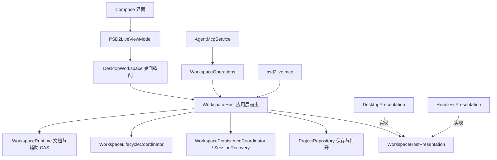

# 창 없는 호스트

[문서 목록](../../README.md) · [에이전트 설계](../agent/AGENT_DESIGN.md) · [MCP 작성 작업](../agent/MCP_AUTHORING.md) · [소재와 Layout](MATERIAL_LAYOUT_WORKSPACE.md)

작업 공간의 애플리케이션 로직은 UI에 의존하지 않는 `application.WorkspaceHost`에 있습니다. 데스크톱 편집기와 창 없는 MCP(`psd2live mcp`)는 이 로직을 구동하는 두 호스트입니다. 편집기는 결과를 Compose 상태에 투영하고, 창 없는 호스트는 아무것도 표시하지 않습니다. 이 문서는 구조, 두 호스트의 차이와 검증을 기록하며, “구현 완료”와 “예정”을 구분합니다.

## 창 없는 호스트가 필요한 이유

창 없는 모드는 에이전트와 외부 생성 도구가 협업하는 주 경로입니다. 외부 도구(이미지 생성, 배경 제거, 분할)는 픽셀만 만들고, 확대 영역 자르기, 배치, 텍스처 밀도, 분류, 리그 생성, 포즈 검사와 내보내기는 모두 PSD2Live 안에서 수행합니다. [소재와 Layout](MATERIAL_LAYOUT_WORKSPACE.md)의 “참조 이미지에서 파츠 분리”와 “벗겨내기”를 참고하세요. 확대 이미지를 캔버스 사각형에 맞춰 되돌릴 때 리샘플링하지 않으므로 파츠의 선명도는 확대 배율과 같습니다. 이 특성은 프로그램 안에서 배치해야 보장할 수 있습니다.

이전의 `psd2live mcp`는 데스크톱 애플리케이션의 `PSD2LiveViewModel`과 `DesktopWorkspace`를 그대로 생성하되 창만 표시하지 않았습니다. 커밋은 UI 사본의 두 번째 CAS를 거쳤고, 작업 중·미저장 상태는 UI 필드를 읽었으며, 수명 주기는 ViewModel에 묶여 있었습니다. 모션 샘플링 등은 메인 창의 GPU 컨텍스트를 기다리다 시간 초과되었습니다.

## 구조(구현 완료)

- **`WorkspaceHost<V>`**(`application/WorkspaceHost.kt`)는 `WorkspaceBackend`를 구현합니다. 런타임, 모든 명령 객체, 초안 큐, 영속화와 복구 체크포인트(`SessionRecovery`), 프로젝트 아카이브 열기·저장(기존 `ProjectController`)을 소유합니다. `V`는 호스트 자체의 표시 스냅샷 형식으로, 작업 시작 시 캡처하고 알림 시 돌려주어 표시 상태가 이미 바뀌었는지 판단하게 합니다.
- **`WorkspaceHostPresentation<V>`**(`application/WorkspaceHostPresentation.kt`)는 호스트가 보는 전체 UI입니다.
  - 읽기: `current` / `withCurrent`, `facts`(작업 중, 미저장, 현재 작업 공간, 캔버스 주소, 표시 필드. `WorkspaceHostFacts` 참고), `visibleLayers`, `auxiliary`, `config`, `basis`. 호스트는 표시 계층의 문서를 읽지 않습니다.
  - 투영: `show`(커밋 안에서 결과를 표시 계층에 전달하며, 표시 계층은 자체 필드 초안을 그 위로 리베이스하고 커밋을 거부하지 않습니다. 아래 “런타임을 유일한 기준으로 사용” 참고), `draftYielded`(큐에 있던 초안의 필드를 다른 커밋에 양보), `savedView`(저장 후 표시되어야 하는 모습으로, 변경 표시의 기준선), 그리고 히스토리·모델·포즈·재생 프레임·흔들림과 시뮬레이션 미리보기·캔버스 가시성·가져오기와 설치·저장 진행률 등의 알림입니다.
  - 아카이브 표시: `encode` / `decode`가 표시 부분(레이아웃, 카메라, 캔버스)과 아카이브 JSON을 상호 변환합니다.
  - 기타: `simulationBake`, `sampleMotion`, `importedSource`(편집기가 직접 분석한 PSD).
- **`DesktopWorkspace`**는 편집기의 얇은 어댑터입니다. `DesktopPresentation`으로 ViewModel을 감싸 호스트를 구성하고, 편집기와 테스트에 필요한 내부 진입점을 전달합니다. 편집기 상태의 문서 필드는 런타임 문서의 투영에 필드 초안을 더한 것이며, 초안은 `WorkspaceDraftQueue`를 통해 커밋합니다.
- **`HeadlessPresentation`**은 창 없는 표시 계층입니다. 초안을 가지지 않으며 `show`와 나머지 모든 알림은 아무 작업도 하지 않습니다. 쿼리에 보고할 프로젝트 ID, 소스, 저장 경로만 기록하고 미저장 여부는 런타임의 `hasUnsavedChanges`를 사용합니다. 아카이브의 표시 JSON은 그대로 왕복시킵니다. 모션 샘플링은 창에 의존하지 않는 Cubism 세션(`CubismSdkPreviewSession.windowless`, `ThreadGpuExecutor`)을 사용합니다.
- **`psd2live mcp`**(`HeadlessMcp`)는 `java.awt.headless=true`를 설정하고 `WorkspaceHost(HeadlessPresentation)` + `WorkspaceOperations` + `AgentMcpService`를 구성합니다. ViewModel, Compose 상태나 창을 만들지 않습니다. 프로세스 하나당 프로젝트 하나이며, 병렬 처리가 필요하면 각자 다른 `--store`를 쓰는 여러 프로세스를 실행합니다. 시작 시 `endpoint`, `token`, `profile`, `store` 외에 `capabilities`를 출력합니다. 현재 값은 `view_sample_motion=yes|no`이며 빌드에 Cubism Core가 포함되었는지를 나타냅니다.

### 두 호스트의 차이

| 항목 | 데스크톱 | 창 없음 |
| --- | --- | --- |
| 문서 필드 | 런타임 문서의 투영에 필드 초안을 더하며, 초안 큐로 커밋 | 별도 필드 없음. 런타임 문서가 곧 표시 상태 |
| 새 소스의 초기 설정 | 편집기의 현재 설정 | `PipelineConfig()`. 편집기 기본값과 동일하며 테스트로 고정 |
| 작업 공간과 캔버스 | 편집기의 탭과 캔버스 | 고정 작업 공간 `main` 하나, 캔버스 없음 |
| 저장 경로 | 수명 주기 기록 또는 편집기 상태 | 수명 주기 기록 또는 마지막 저장 / 열기 경로 |
| 모션 샘플링 | 메인 창의 Cubism 세션 | 독립 스레드의 창 없는 세션 |
| 진행률 | 상태 표시줄. 시뮬레이션 베이크에는 별도 편집기 베이크 표시줄도 있음 | 프로세스 작업 자체의 진행률 |

## 런타임을 유일한 기준으로 사용(구현 완료)

런타임(`WorkspaceRuntime`)은 문서의 유일한 기준이며, 편집기 상태의 문서 필드는 **필드 초안**일 뿐입니다. 바꾸지 않은 필드는 항상 런타임 문서의 투영이고, 바꾼 필드는 `WorkspaceDraftQueue`를 통한 커밋을 기다립니다. 편집기가 “다른 것을 표시하고 있다”는 이유로 어떤 커밋도 거부하지 않습니다.

### 규칙

- **투영이 곧 리베이스**: 호스트는 커밋 안에서 `WorkspaceHostPresentation.show(view, preview, base, next, …)`를 호출하며 더 이상 불리언을 반환하지 않습니다. `base`는 표시 계층의 “바꾸지 않은 필드”가 같아야 하는 문서입니다. 외부 커밋(MCP, 명령)이면 커밋 전 런타임 문서, 편집기 자체 초안이면 커밋 시 보낸 초안 문서입니다. 표시 계층은 필드별 3방향 병합 `WorkspaceDraftRebase.rebase(base, draft, next)`를 수행합니다.
  - 초안 필드가 `base`와 같으면 `next`를 사용하고, `next`가 `base`와 같으면 초안을 유지하며, 둘이 같으면 `next`를 사용합니다.
  - 맵 필드(레이어 가시성, 오버라이드, 부모, 메시 오버라이드, 텍스처 오버라이드)와 설정 JSON은 키별로 병합합니다.
  - `rigEdits`에서 양쪽 모두 `authoringJournal`에 추가만 했다면, 초안이 추가한 명령을 `next`의 저널 뒤에 붙입니다. 명령 단위 리베이스이며 초안이 외부 편집보다 나중에 실행되는 것과 같습니다.
  - 나머지에서 양쪽이 모두 바꾼 필드는 **충돌**입니다. 런타임이 우선하며 해당 필드의 초안을 버리고 편집기 로그에 경고합니다.
- **체크아웃으로 교체**: 실행 취소, 다시 실행, 분기 전환(`checkoutHistory`)은 `base = null`을 전달합니다. 표시 전체를 체크아웃한 문서로 바꾸고 미커밋 초안은 버리며 로그에 경고합니다(마지막으로 표시한 커밋과 비교합니다. 프로젝트를 막 열어 아직 커밋을 표시하지 않았다면 체크아웃 문서와 비교합니다). 편집기의 필드 세션에서 재실행을 기다리는 설정 전환, 양보하거나 변경된 설정 키, 기록 대기 중인 객체 편집을 같은 상태 갱신 안에서 지웁니다. 호스트가 나중에 초안 큐를 버리는 `discardDrafts`를 기다릴 필요가 없으므로, 체크아웃 상태가 게시된 뒤 끝나는 필드도 전환을 체크아웃 후 문서에 재실행하지 않습니다.
- **초안 커밋의 시작점**: 편집기는 필드 세션 시작 시점이 아니라 초안을 커밋하는 시점에 상태 잠금 안에서 초안 문서, **마지막으로 표시한 커밋 문서**(`origin`, 초안의 미변경 필드가 반영하는 런타임 문서), 런타임 상태 토큰을 읽어 함께 `WorkspaceEditorDraft`로 커밋합니다. `origin`은 `show` 때마다 갱신하며 프로젝트 열기, 새 소스 가져오기, 교체 가져오기 때에도 로드한 문서로 바뀝니다. 런타임은 잠금 안에서 먼저 `show`를 호출한 뒤 상태를 게시하고, 게시 동작은 편집기의 상태 잠금 밖에서 이루어집니다. 따라서 읽은 토큰은 `origin`에 해당하는 커밋보다 이전일 수 있습니다. 토큰은 첫 CAS의 예상값으로만 쓰며 충돌 시 큐가 `origin`을 기준으로 초안을 현재 상태로 옮깁니다. 외부 편집이 누락된 초안이 새 토큰을 가진 상황은 생기지 않습니다(`origin`은 항상 초안이 본 상태보다 오래되지 않습니다). 이전의 세션 시작 스냅샷 `editorDraftExpected`는 삭제했습니다.
- **초안 큐 리베이스 재시도**(양보한 설정 키는 후보 준비 시 해당 설정 전환 전체와 함께 철회하므로 전환에서 파생된 키와 해제된 포즈도 반영되지 않습니다): 큐의 초안이 실행될 때 외부 커밋 때문에 `WorkspaceConflict`를 만나면, `origin`(또는 같은 상태의 런타임 문서)을 `base`, 현재 런타임 문서를 `next`로 삼아 초안을 리베이스하고 새 상태로 재시도합니다. 표시 계층과 같은 규칙으로 양쪽이 바꾼 필드는 런타임 값을 사용하고 나머지는 정상 커밋합니다. 양보한 필드는 `draftYielded`로 편집기 로그에 경고합니다. 연속해서 `MAX_REBASES`번을 초과해 추월되거나 `origin`을 모를 때만 거부합니다. 거부 후 복구도 `show`(`base` = 거부된 초안)를 거치며, 초안 이후 다시 바뀌지 않은 필드만 철회합니다.
- **저장은 다시 쓰지 않음**: `captureProject`는 더 이상 편집기 버전 문서를 “Save project” 노드로 런타임에 커밋하지 않습니다. 저장 전에는 기존처럼 필드 세션을 끝내고 초안 큐를 기다리되, 이후 런타임의 캡처만 저장합니다. 저장 시 변경 표시의 기준선은 `savedView`입니다. 편집기 상태에 저장한 캡처의 문서 필드를 적용하므로, 편집기에는 여전히 초안이지만 런타임에는 없는 필드는 저장 후에도 변경 상태이고 닫을 때 안내합니다. `checkpoint`는 여전히 런타임 문서에 강제로 노드를 추가합니다. `WorkspaceHostPresentation.document`를 삭제하여 호스트가 더 이상 표시 계층의 문서를 읽지 않습니다.

### 커밋과 저장 시점의 변화

| 상황 | 이전 | 현재 |
| --- | --- | --- |
| 필드 세션 중 MCP가 다른 필드를 수정 | MCP 커밋 거부(“Workspace changed while the operation was being built”) | MCP 커밋 성공. 편집기는 초안 필드를 유지하고 세션 종료 시 새 상태에 커밋 |
| 필드 세션 중 MCP가 같은 필드를 수정 | MCP 커밋 거부 | MCP 커밋 성공. 해당 필드 초안을 버리고 경고 |
| 초안이 큐에 들어갔지만 커밋 전일 때 MCP가 먼저 커밋 | 초안이 CAS 충돌로 거부되고 편집기가 되돌아감 | 초안을 리베이스해 재시도. 같은 필드는 런타임 값을 쓰고 경고하며 나머지는 정상 커밋 |
| 저장할 때 초안 커밋을 거치지 않은 편집기 필드가 있음 | “Save project” 노드로 커밋한 뒤 저장 | 커밋하지 않음. 런타임 문서만 저장하고 프로젝트는 변경 상태 유지 |
| MCP 실행 취소 / 체크아웃 시 편집기 초안이 있음 | 체크아웃 거부 | 체크아웃 성공. 초안을 버리고 경고 |

필드 세션의 설정 전환(`editorSettingsIntents`)은 초안과 함께 명령으로 재실행합니다. 재실행은 다른 키를 파생시킵니다(예: `meshOnly`가 `generateDeformers`를, 모션 토글이 `exportMotions`를 파생). 불리언 파생 키는 필드 비교에서 아예 충돌하지 않을 수 있으므로, 편집기는 양보한 설정 키 두 종류를 기록해 초안과 함께 큐에 전달합니다(`yieldedSettings`). 재실행 후 이 키들은 런타임 값으로 복원합니다. 두 종류는 투영에서 충돌로 판정한 키(전환에서도 동시에 제거), 세션 중 다른 커밋이 바꾼 키입니다. 둘 다 세션에 재실행 대기 전환이 있을 때만 기록하고, 각 세션 시작 시 비우며, 커밋 시에는 편집기가 이후 다시 바꾸지 않은 키(초안 값이 여전히 `origin`과 같은 키)만 남깁니다. 사용자가 양보한 뒤 직접 다시 바꾼 값은 정상 커밋합니다. 초안 미리보기(`schedulePreviewRebuild`)를 빌드하는 동안 커밋이 반영되면 미리보기는 오류를 보고하지 않고 `WorkspaceConflict`로 끝나며, 해당 커밋을 표시할 때 초안 필드가 남아 있으면 미리보기를 다시 예약합니다.

위험: 상태 필드만 바꾸고 `editorChanged` / 명령으로 커밋하지 않는 편집기 경로(“유령 초안”)가 남아 있다면, 이전에는 저장이 이를 대신 커밋했지만 지금은 프로젝트에 들어가지 않으며 프로젝트는 변경 상태로 남습니다. 이러한 경로는 결함으로 보고 종료 시 복원하거나 초안 커밋으로 바꿔야 합니다. 이미 수정한 사례: 모션 키프레임 드래그 종료 시 항상 커밋된 클립으로 복원하며, 디포머 삭제는 더 이상 로컬에서 구형 v1 부모 오버라이드를 삭제하지 않습니다(저널의 삭제 명령이 담당).

모션 키프레임 드래그도 필드 초안과 같은 규칙을 따릅니다. 드래그 중 다른 작성자가 커밋했더라도, 드래그 대상 클립이 커밋 문서에서 여전히 드래그 시작 시 모습이라면 현재 상태로 커밋합니다. 클립이 바뀌었다면 드래그가 양보하고 경고합니다. 드래그 종료 시 읽은 상태는 이미 표시한 커밋보다 이전일 수 있으므로, 커밋 충돌 시 충돌이 제공하는 상태로 클립을 다시 판단하고 재시도합니다(`MOTION_DRAG_REBASES`). 드래그의 커밋 여부는 드래그 요청이 발생했는지만으로 판단하며, 커밋을 표시하면서 충돌로 교체된 드래그 미리보기에는 영향받지 않습니다.

필드 초안 커밋은 하나의 상태 잠금 구간에서 세션(전환, 양보한 설정 키와 바뀐 설정 키, 효과)을 가져오고 초안과 `origin`을 읽습니다. 두 동작 사이에 커밋이 끼어들지 않습니다. 각 설정 전환의 미리보기 효과(모션 실행, 물리 초기화 등)는 해당 변경과 짝으로 저장하며, 양보 때문에 전환 전체를 철회하면 효과도 실행하지 않습니다.

시뮬레이션 베이크의 진행률과 취소는 두 호스트에서 같습니다. 명령은 `WorkspaceSimulationWork.cancellable`로 자신을 실행하는 프로세스 작업(`WorkspaceJobContext`)에 진행률을 보고하고 작업 취소에 따라 중단합니다. `simulationBake`는 표시 계층의 관찰 진입점일 뿐입니다. 데스크톱은 이를 통해 베이크 표시줄과 취소 버튼을 표시하고 창 없는 호스트에서는 아무 작업도 하지 않습니다.

## 외부 도구의 연결 방법

외부 스크립트는 프로그램이 할 수 없는 작업(이미지 생성 서비스 호출, 외부 배경 제거 모델)만 수행하고, 프로그램과는 MCP로만 픽셀을 교환합니다.

1. `material_crop`(`canvas_rect`)으로 확대 영역 자르기 → `material_export_png`로 외부에 전달.
2. 외부에서 고해상도 이미지 출력 → `material_import` → `material_set_placement`(`from`에 확대 이미지) → 레이어별 `material_peel` → `layer_place`.
3. 정렬, 밀도, 분류, 생성, 포즈 검사, 내보내기는 모두 프로그램 내부 작업으로 수행합니다.

따라서 외부 코드는 PSD 직접 작성, 캔버스 기준 리샘플링, 콜라주 합성, 비교 이미지 직접 그리기를 할 필요가 없습니다. 외부에 남는 것은 생성 서비스 클라이언트와 워크플로뿐입니다(메인라인 밖에 있으며 `comfy-tools` 분기 참고). 스크립트는 프로그램과 함께 배포하는 `mcp_proxy.py`(`Client` 또는 `call` / `operations` 명령줄 모드)로 작업을 호출합니다.

## 예정 작업

- **초안 범위 축소**: 편집기 상태는 아직 모든 문서 필드를 초안 저장소로 유지하며, 커밋 시 전체를 보내고 필드별로 리베이스합니다. 바뀐 필드만 기록하도록 바꿀 수 있으며, 그때 `WorkspaceStateCodec.document`는 새 소스를 가져올 때만 사용합니다.

## 검증

- `LayerDependencyTest`: `application`, `agent`, `project`, `core`, `history` 패키지와 `HeadlessMcp`가 `ui` 및 Compose를 참조하지 않습니다.
- `HeadlessHostScenario`:
  - 창 없는 호스트가 MCP로 새 Layout 프로젝트 생성, 가져오기, 참조 이미지, 확대 영역 자르기, 배치, 태그, 생성, 참조 차이 포함 렌더링, 다른 이름으로 저장, 저장, 다시 열기와 내보내기를 완료합니다.
  - 같은 호출 집합이 데스크톱과 창 없는 호스트에서 같은 문서 리비전을 만듭니다.
  - 창 없는 호스트의 기본 설정은 편집기 기본값과 같습니다.
- 실측: `psd2live mcp` 프로세스에서 `mcp_proxy.py`의 `Client`로 Layout과 벗겨내기 흐름을 끝까지 실행했으며, 창 없는 모드의 `view_sample_motion`은 약 1초 만에 샘플 모음 이미지를 반환합니다.
- 편집기 시나리오(`SaveAndCloseTest`, `EditorAndAgentScenario` 등)와 모든 테스트를 통과했습니다. 포함 항목:
  - `EditorDraftRebaseTest`: 필드 리베이스, 맵과 설정의 키별 병합, 저널 추가의 명령 단위 리베이스, 같은 필드 충돌. 초안 큐의 초안이 외부 커밋을 넘어 재시도하고 같은 필드는 런타임에 양보하며 나머지는 정상 커밋합니다. 외부 커밋의 상태 게시 전에 읽은 초안도 `origin`으로 반영됩니다(`origin`이 없으면 거부).
  - `EditorAndAgentScenario.anAgentEditDuringAnOpenFieldLandsAndTheFieldCommitsOverIt`: 필드 세션 중 MCP 커밋이 성공하고 초안은 유지되어 그 위에 커밋합니다. 같은 설정을 MCP가 바꾸면 초안이 양보합니다.
  - `EditorAndAgentScenario.savingRecordsTheRuntimeAndNotTheEditorsCopy`: 저장은 리비전을 추가하지 않고 미커밋 편집기 필드를 아카이브에 쓰지도 않으며 프로젝트는 변경 상태로 유지합니다.
  - `SaveAndCloseTest.aGestureOverAnExternalCommit…`: 외부 커밋을 넘어간 제스처는 정상 커밋하고 같은 설정은 양보하며, 이후 저장하면 변경 상태가 해제됩니다.
  - `SaveAndCloseTest.aSettingYieldedInAFieldKeepsTheAgentsValueWhereASwitchWouldDeriveIt`: 세션의 파생 키는 에이전트가 쓴 값을 유지합니다.
  - `SaveAndCloseTest.aCheckoutDiscardingAFieldWarnsAndForgetsItsSwitches`: 체크아웃이 초안을 버리면 경고하고, 세션 종료 시 전환을 체크아웃 후 문서에 다시 실행하지 않습니다.
  - `SaveAndCloseTest.deletingADeformerLeavesNoDraftBehind`, `aMotionKeyDragOvertakenByAnAgentCommitLeavesNoDraftBehind`: 두 경로가 끝나면 편집기는 런타임 문서만 표시하며, 대상 클립을 바꾸지 않은 커밋이 드래그를 추월한 경우 드래그는 정상 커밋합니다.
  - `SaveAndCloseTest.aFieldClosingBetweenACommitsShowAndItsPublicationStillLands`: 런타임 테스트 훅으로 커밋이 표시되었지만 아직 게시되지 않은 정확한 시점에 필드가 상태를 읽고, 게시 후에야 큐에 들어가도록 하여 초안이 `origin`으로 반영됨을 검증합니다.
  - `SaveAndCloseTest.aYieldedSwitchLeavesOutWhatItDoesToThePreview`, `aMotionKeyDragEndingBeforeACommitsPublicationFollowsIt`: 양보한 전환은 미리보기 효과를 실행하지 않습니다. 커밋 게시 전에 끝나 이전 상태를 가진 드래그도 해당 커밋을 따라간 뒤 반영됩니다.
  - `SaveAndCloseTest.aValueTheEditorTakesBackAfterYieldingItIsCommitted`, `aReplacingImportIsWhatTheEditorMirrorsAfterwards`, `aCheckoutRightAfterOpeningDiscardsAFieldWithAWarning`, `aReplacingShowEndsTheSessionsSwitchesBeforeTheHostDiscardsItsQueues`: 양보한 뒤 다시 바꾼 값, 교체 가져오기 후 반영되는 문서, 열기 직후 체크아웃의 경고, 체크아웃 표시 시 세션을 즉시 비우는 동작을 검증합니다.
  - `HeadlessSimulationBakeTest`: 창 없는 베이크가 프로세스 작업에 진행률을 보고하고 작업 취소 즉시 중단합니다.
