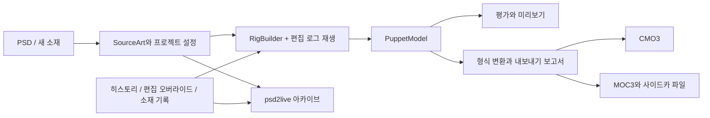

# 프로젝트, 런타임과 내보내기의 경계

[문서 목록](../../README.md) · [프로젝트 형식](PROJECT_FORMAT.md) · [구현 개요](IMPLEMENTATION_COMPARISON.md)

현재 소스 코드를 기준으로 정리했습니다. 파서에 유형이 존재하는 것, 원본 파일의 알 수 없는 필드를 보존하는 것, UI에서 편집할 수 있는 것, 대상 소프트웨어에서 같은 효과가 나는 것은 서로 다른 네 단계의 지원 수준입니다.

## 데이터 흐름

| 계층 | 주요 오브젝트 | 책임 |
| --- | --- | --- |
| 프로젝트 | `SourceArt`, `WorkspaceDocument`, 히스토리와 소재 라이브러리 | 원본 픽셀, 분류, 설정, 구조와 재생 가능한 편집 저장 |
| 런타임 | `PuppetModel` | 파라미터, Part, Warp / Rotation, ArtMesh, Glue, 키폼, 채널과 그리기 관계 |
| 형식 | `Cmo3Model`, `MocDocument` | 편집기 오브젝트 그래프와 런타임 파일 구조 |
| 평가와 전달 | CPU / 네이티브 미리보기, 변환기, Pipeline, Sidecars | 샘플링, 렌더링, 파일 묶음 출력과 손실 진단 |

PSD 가져오기와 이미지 프로젝트 생성은 독립 애플리케이션 계층 `WorkspaceSourceImporter`를 공유합니다. 읽기 전에 상태를 캡처하고, 이전 프로젝트 오버라이드를 지운 뒤 재구축해 새 ID/로드 세대를 CAS로 설치합니다. GUI 분석은 신뢰된 호출과 투영을 담당하고 MCP는 프로세스 작업을 반환합니다. 미저장 상태에서의 전환은 기본적으로 거부하며 명시적으로 버리기를 선택한 뒤에만 교체를 허용합니다. 작업을 취소해도 이미 설치된 결과를 롤백했다고 보고하면 안 됩니다.

프로젝트를 다시 열면 리그를 재구축하고 편집을 재생합니다. 새 기능이 `PuppetModel`만 바꾸고 원본 프로젝트나 영속 편집 로그에 들어가지 않으면 재구축 후 사라집니다. 캔버스, MCP와 저장 절차 모두 이 경계를 따라야 합니다.

### Cubism 대응 필드의 기준 형식

Cubism과 일대일로 대응하는 편집 가능 데이터는 Cubism의 단위, 범위와 의미를 유일한 기준 형식으로 삼습니다. 생성 설정, 모델, 편집 로그, 인스펙터와 내보내기가 이 형식을 공유합니다. 알고리즘에 필요한 로컬 좌표나 정규화 비율은 계산 경계에서만 일시적으로 변환하며 별도의 편집 상태로 저장하지 않습니다.

변형 경로의 `width`는 CMO3 `lineWidth`에 직접 대응하는 캔버스 픽셀 단위 영향 반경이며 기본값은 `50`입니다. `hardness`는 `lineHardnessPercent`에 직접 대응하고 범위는 `0–100`, 기본값은 `50`입니다. 생성 시 더 이상 메시 크기에 비율을 곱해 반경을 계산하지 않습니다. 닫힘 상태, 모서리 점과 편집 계층은 기존 의미 매핑을 유지합니다.

새 경로 로그는 `path_units: "cubism"`을 포함합니다. 이 표시가 없는 옛 로그를 읽을 때는 부모 디포머 체인을 따라 로컬 반경을 캔버스 반경으로 바꾸고, 기존 경도 비율에 `100`을 곱합니다. 다시 인코딩한 뒤에는 기준 형식을 사용해 중복 변환을 피합니다. CMO3 가져오기와 내보내기는 네이티브 반경과 경도 수치를 직접 읽고 씁니다.

## 현재 제품 진입점

주 캔버스는 선택, 변형, 메시 토폴로지, 디포머 생성, 글루, 경로와 페인트 세션을 제공합니다. 파라미터, 인스펙터, 애니메이션과 물리 패널이 해당 제어 기능을 제공합니다.

GUI와 MCP는 애플리케이션 계층 명령을 공유합니다. 파라미터는 `parameter_create/update/delete`, 뼈대와 모션 클립은 `skeleton_* / motion_*`, 기존 원본 레이어 분류는 `layer_classify`, 캔버스 구조와 토폴로지는 `canvas_* / rig_edit_structure`, 프로젝트 설정과 모델 내보내기는 `settings_update / project_export_model`, 모델 프리셋은 `model_apply_preset`을 공개합니다. 소재는 PSD 가져오기, CMO3 새로 만들기/교체 가져오기, 이미지 프로젝트 생성과 원본 이미지 페인팅을 지원합니다. 원본 이미지 분할(`source_split_components/source_split_polygon/source_split_depth`)은 백그라운드 작업이자 일괄 멤버이며, GUI와 후보/재구축/CAS를 공유합니다. 생성된 모델에서 파츠는 `art_primitive` 기록으로 원래 레이어를 대체하고, 기존 키폼, 채널, 블렌드 셰이프, 경로, 정점 가중치와 글루를 가져옵니다. 가져온 CMO3 모델은 기존 기록을 사용합니다. 연결 요소와 다각형 분할은 원래 레이어를 소프트 삭제하며, 깊이 분할은 원본 메시 위에 앞 레이어를 복제합니다([문서 계층](DOCUMENT_LAYER.md#분할-실체화-아트-프리미티브-레코드-art_primitive) 참고). 레이어별 메시 설정, 미리보기 파라미터 세션과 PSD 내보내기도 있습니다. 저수준 오브젝트 메서드를 자동으로 공개 인터페이스로 간주해서는 안 됩니다. 자세한 내용은 [MCP 계약](../agent/MCP_AUTHORING.md)을 참고하세요.

`org.umamo.edit`의 범용 편집 세션 역시 PSD2Live 히스토리의 유일한 기준 진입점은 아닙니다. 하위 편집 기능을 연결할 때는 작업 공간에서 저장하고 재생할 수 있는 작업으로 변환해야 합니다.

## 형식 지원 범위

| 내용 | 현재 기능 | 구분해야 할 경계 |
| --- | --- | --- |
| 메시, Warp / Rotation, 파라미터, 일반 키폼 | 핵심 모델, 편집과 내보내기 | 부모를 바꾸어 바인딩한다고 전체 움직임이 보존되는 것은 아님. 원본 이미지 / 파라미터 설정이 생성 결과에 영향 |
| 색상, 불투명도, 그리기 순서, 마스크 | 모델과 편집 채널 | 대상 버전과 형식의 표현 능력에 따라 기능이 줄어들 수 있음 |
| Glue | 모델, 시각적 생성, 브러시 연결, 방향 가중치와 키폼 | 짝 복구와 진단 도구는 아직 제한적 |
| Blend Shape, Part 그리기 그룹 등 | 하위 모델과 형식 매핑 | 완전한 제품 편집 흐름에는 아직 부족한 부분이 있음 |
| 변형 경로 | 작업 공간 편집, CMO3 컨트롤러, MOC3 베이크 | 단일 ArtMesh. 공식 편집 알고리즘과 같다고 주장하지 않음 |
| 물리 | 통합 물리 그룹 목록(프리셋 / 뼈대 / 흔들림 / 사용자 정의, 수정·끄기·복원·계산 순서 조정 가능), 다중 입력·출력과 1–16개 진자, 계산 FPS, physics3.json 가져오기, 입력 및 진자 프리셋, 패널 시각 편집, MCP `physics_put/delete/simulate/fit/config/import`, `physics_audition*` 시험 재생과 `physics_preset_*` 프리셋, Cubism 방식으로 평가하는 소프트웨어 미리보기 | 입력 / 출력 유형은 위치X와 각도로 제한(CMO3 지원 범위). 바람 등 전역 물리 설정은 미포함 |
| 모션 | 기본 모션 생성과 재생. 애니메이션 패널 및 `motion_*`로 클립, 파라미터 곡선과 타임라인 키프레임 편집(보간 유형, 핸들, 키 이동 / 붙여넣기 / 교체) | 생성된 기본 모션은 같은 이름의 오버라이드 클립(`motion_seed_builtin`)으로 변환한 뒤 편집해야 함. 내보내려면 `exportMotions`를 켜야 함 |
| Expression / Pose / UserData | 프로젝트 데이터(`core/ModelSidecars.kt`, `MotionClip.events`, 메시 사용자 데이터), 애니메이션 패널 및 `expression_*` / `pose_*` / `motion_set_event` 편집, exp3 / pose3 / motion3 `UserData` / userdata3 내보내기. [내보내기 대상](EXPORT_TARGETS.md#표정-포즈-이벤트) 참고 | 편집 캔버스와 미리보기에는 pose를 적용하지 않음(미리보기 bundle에는 pose3 없음). 모션에는 파츠 불투명도 곡선이 없고, pose는 로드할 때 각 그룹의 첫 파츠만 표시. cmo3 / can3에는 표정과 pose를 저장하지 않음 |
| ArtPath, Motion Sync, 확장 보간과 일부 편집기 메타데이터 | 유형이나 원래 오브젝트 그래프가 존재할 수 있음 | 이 사실만으로 PSD에서 생성하거나 의미를 완전히 편집할 수 있다고 주장할 수 없음 |

CMO3 새로 만들기와 교체 가져오기는 애플리케이션 계층 `WorkspaceCmo3Importer`를 공유합니다. 파일에서 재구축 가능한 원본 이미지와 가져온 리그를 준비하며 PSD 자동 리그나 모션 프리셋은 적용하지 않습니다. 교체는 ID에 따라 업데이트하고 나타나지 않은 오브젝트는 유지합니다. 문서와 포즈 초기화는 CAS 한 번으로 수행합니다. GUI와 MCP는 같은 원본 이미지 기능을 호출하며 MCP 가져오기는 프로세스 작업을 사용합니다. 지원 범위는 여전히 통합 모델과 변환기에 의해 제한됩니다.

CMO3 형식 라이브러리는 원래 오브젝트 그래프의 일부 알 수 없는 정보를 보존할 수 있지만, PSD로 CMO3를 새로 만들 때는 모델링된 데이터만 합성할 수 있습니다. 이는 형식 라이브러리의 기능이며 주 프로그램에서 모든 CMO3 프로젝트를 바로 열 수 있다는 뜻은 아닙니다. MOC3는 통합 모델에서 합성하므로 같은 방식의 알 수 없는 필드 전달에 의존할 수 없습니다.

## 파일 묶음과 검수

`.moc3`는 모든 실행 설정을 포함하지 않습니다. 텍스처, `.model3.json`, 표시 정보, 물리와 모션 등은 사이드카 파일이 함께 표현하며 출력 여부는 설정과 모델 파라미터에 달려 있습니다.

파이프라인은 중립 포즈, 머리 포즈, 방향성 디포머와 형식 재읽기를 검사하고 진단과 경고를 출력합니다. 파일이 있다는 것은 쓰기에 성공했다는 뜻일 뿐입니다. 보고서, 대상 버전에 따른 제거 사항과 실제 시각적 효과도 확인해야 합니다. 정식 전달 시에는 대상 런타임에서 파일 묶음 전체를 로드하고, 편집을 계속할 CMO3는 대상 편집기에서 확인해야 합니다.

## 후속 작업

중점 사항은 사이드카 자산 모델 통합, 완전한 Blend Shape / Glue 편집, 확장 보간, 더 많은 물리 구조, 내보내기 손실의 일관된 표시와 실제 호환성 사례입니다. 제품 계획은 [로드맵](../ROADMAP.md)에서 관리하며 검증되지 않은 완료 상태를 여기에 복제하지 않습니다.

새 기능은 최소한 도메인 데이터 → 히스토리 재생 → 프로젝트 저장·복원 → 대상 버전 처리 → 내보낸 파일 재읽기 → 시각적 검사를 포함해야 합니다. 테스트가 실제로 다루는 범위만 호환성 결론으로 쓸 수 있습니다.

소스 코드: [프로젝트](../../../src/main/kotlin/io/github/psd2live/project/) · [핵심 파이프라인](../../../src/main/kotlin/io/github/psd2live/core/) · [런타임](../../../umamo/src/main/kotlin/org/umamo/runtime/) · [형식 변환](../../../umamo/src/main/kotlin/org/umamo/interop/).
